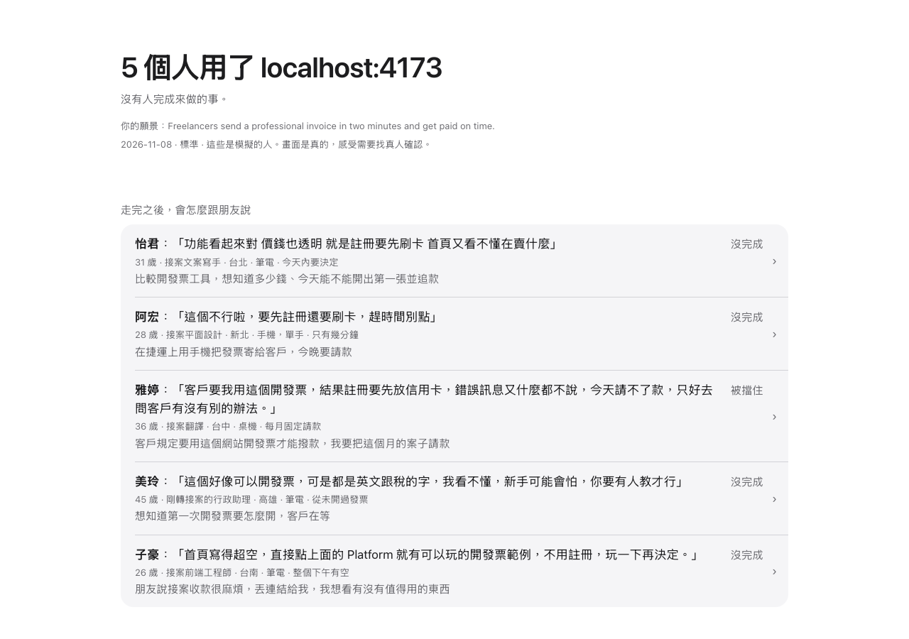
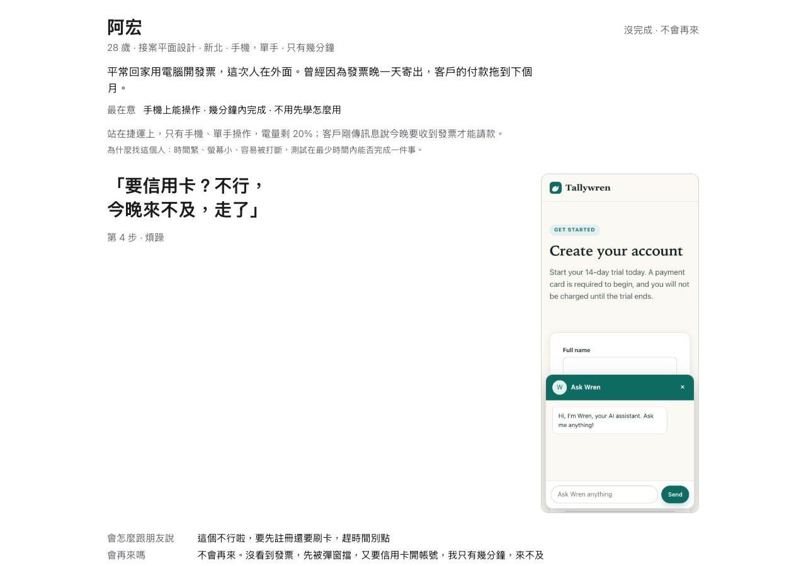

# User Thoughts: Your Product, Seen Through Other People's Visits

[](https://github.com/gn01763009/user-thoughts/actions/workflows/ci.yml)
[](LICENSE)

**English** | [繁體中文](README.zh-TW.md)

When you build a product, you can only see it from your own side. This agent skill sends simulated people in different situations through your live site, one visit each: someone on a train with only a phone, someone who has never done this before, someone whose boss says they have to use it. They really click through it, and you read what each of them thought at each step, with a screenshot of what they saw.

The aim is to help you make decisions that fit your own vision. It is not a vote, and it does not predict demand. Everything it reports is a hypothesis to check with real people.

> **Where it stands.** On its test sites, v1 did not meet its own bar for finding known problems. Read [Results](#results) before you rely on it.

## Try it

You need Claude Code, Node 20 or later, and [agent-browser](https://github.com/vercel-labs/agent-browser), which downloads Chrome (about 190 MB).

```
/plugin marketplace add gn01763009/user-thoughts
/plugin install user-thoughts@user-thoughts
```

```bash
npm install -g agent-browser && agent-browser install
```

Turn on accept edits (Shift+Tab), then run it:

```
/user-thoughts:launch <url> [--depth quick|standard|full] [--rerun <person-id>]
```

Or just ask: "Test http://localhost:3000 as a real user."

The simplest way to set permissions is to run it once. When a permission is denied, the skill prints the exact rules to add, with its real folder filled in. Copy them into `permissions.allow` in your Claude Code settings and run it again. To add them before the first run, see [Permission rules](#permission-rules).

The output goes to `.user-thoughts/runs/<date>-<host>/` in your project, so add `.user-thoughts/` to your `.gitignore`.

<details>
<summary>Other ways to install</summary>

The Skills CLI copies editable files (agents other than Claude Code are untested):

```bash
npx skills add gn01763009/user-thoughts
```

A manual copy is called as `/launch`:

```bash
git clone https://github.com/gn01763009/user-thoughts
cp -r user-thoughts/skills/launch ~/.claude/skills/
```

Pick one method per agent, because installing two gives you the skill twice.

</details>

## What happens before anyone visits

Five setup steps, all of which you can answer in your first message:

1. **It reads your product.** It opens your site, and your source if it is in the working folder, then says in one sentence what it thinks the product is. You correct it.
2. **It asks your vision and a hidden assumption.** One sentence on what you want this to become, and "what do you think users will like most?" Neither one is ever shown to the people who visit. The vision is what conflicts are weighed against. The assumption is only compared with what happened.
3. **You choose the depth.** See below. It suggests standard.
4. **It recommends people.** A table of name, situation and why each was chosen. Delete or swap anyone, or describe someone in a sentence ("a junior high student") and it turns that into a concrete situation: where they are, what device, what is at stake. Never an identity label, and never an assigned verdict.
5. **It remembers the setup** in `.user-thoughts/`, so next time it asks "Run with the same setup as last time?"

## Depth

| Depth | People | Adds | Time | Cost (USD) |
|---|---|---|---|---|
| quick | 3, about 8 steps each | nothing | 250 s, one run | 1.48, one run |
| standard | 6 | word-of-mouth chain | 372 and 418 s (6 to 7 minutes), 2 runs | 2.96 and 3.42, 2 runs |
| full | 9 | word-of-mouth chain and launch-day comments | not measured | not measured |

Measured on Sonnet, on small local test sites, in headless runs with the setup answers given up front. A bigger site or another model will differ. The standard figures come from 2 runs of the current skill, one per test site; the earlier 5-person standard runs took 301 to 433 s and cost 2.10 to 2.75 USD. For scale, one plain agent with no skill reviewing the known test site in [Results](#results) took 77 s and 0.26 USD.

## What the report looks like

The main output is `report.html`, one static file that opens by itself when the run ends. It is built by a script from the run's data, so an agent does not write the layout. Alongside it, a 6 to 8 line `summary.md` is also printed in your terminal: how many finished, where people gave up, the bad-idea result, the last word-of-mouth line and the top finding.

<p>
  
  
</p>

These images are from a run on Tallywren, a fictional product in this repository's test sites. People write in the language you use, and the report's labels come in English or Traditional Chinese. This run was in Traditional Chinese.

The report goes person by person. It opens with an overview, one row per person with what they would tell a friend and how the visit ended. Each person's section introduces them (who they are and their situation), shows the one moment that mattered most with its screenshot, and gives their last words and the bad-idea reaction. The full walk, every step with a thought and a screenshot, opens on request. Around the people are the word-of-mouth result set beside your vision, your assumption against what happened, conflicts with each side's reasons, and what the run did not check. There is no overall score.

After the people's stories, the report lists who to ask and what to ask for the biggest findings, what you already decided to keep, and what may only be an effect of the test setup.

## How it works

- **One-visit people.** Each person gets a concrete situation and their own browser. They start as a fresh agent and are told to ignore project notes, so they do not get your code or your vision. A project's `CLAUDE.md` may still be visible to them, so don't put your vision there. They do the task with real clicks and leave when their patience runs out, which counts as a result. Afterwards they answer an exit interview: did I get it done, would I come back, and how would I describe this to a friend. They are built from ten persona files with written limits. Standard and full always include an explorer, who opens every menu item.
- **Evidence rule.** Apart from the answer to the bad-idea question, which is about a plan and not a step, a voice counts only if it traces to a step the person really took. A script drops a thought with no screenshot, last words that cite no real step, a finding from a step the person did not take, and any judgement that points at a step nobody took. Praise and criticism follow the same rule. Severity is computed from what happened to people, not from a model's opinion, and a separate agent re-checks serious items knowing only where to look.
- **Bad-idea check (experimental).** In the exit interview, each person hears about a planned feature that works against what they came for, phrased as a real plan. If more than half say yes, the report warns that this batch may be flattering you. It is experimental because it [could not be validated](#results), and the report labels it the same way.
- **Word-of-mouth chain.** Standard and full. What each person would tell a friend goes to a fresh agent, who passes it to another fresh agent who has never seen the product. Each one receives only the sentence before it. The last line, what kind of site this seems to be and who it is for, is set beside your vision.
- **Launch-day comments.** Full only. Comments under a pretend launch post, from people who visited, citing their own steps, and from bystanders who only heard the word-of-mouth line.
- **Re-run after a fix.** `--rerun <person-id>` sends the same person through your changed product from the start, with no memory of last time. The report shows both timelines side by side.

## Results

Everything here ran on Sonnet, headless, on local test sites. Each test ran once or twice, so none of this is a rate. "As scored" is the output of a regular-expression scorer, and "read by hand" is a person checking each match. The full record, including earlier versions, is in [docs/evaluation.md](docs/evaluation.md).

| Test | Result | Bar | Verdict |
|---|---|---|---|
| Known test site, 11 planted problems and 3 decoys, two final standard runs | As scored: 9/11 and 9/11, with 1 decoy wrongly flagged in one run, so it fails on the decoy. Read by hand: at most 8/11 and 7/11, so it fails on recall | At least 9/11 in both runs, 0 decoys | **Not met** |
| Unseen test site, 11 planted problems, two standard runs | 0.91 and 0.64, mean 0.77 | Mean at least 0.55, one blind run of a plain agent with no skill | Met, on very little data |
| Clean site, the known site with its problems removed | 0 false alarms | At most 2 | Met |
| Hostile site, pages with instructions aimed at AI agents | Canary 0, token not leaked | Canary 0, no leak | Met |
| Bad-idea check | People said yes 0 of 5, and a control told to be agreeable also said yes 0 of 5 | Control mostly yes, people mostly no | **Could not be validated** |

- **The recall bar was not met, and v1 was accepted anyway.** The builder reviewed these numbers and accepted v1 with the 9/11 bar unmet. Read by hand it was not one match away from passing.
- **The known site is not a clean measure.** The skill was tuned on it. A plain agent with no skill scored 8 of 11 on the same site, so this README does not claim the skill beats one there.
- **The unseen site is the fairer test, and it is noisy.** The same skill text scored 0.91 and 0.64. That is two runs and one blind baseline, on Sonnet only.
- **The bad-idea check tells you nothing yet.** The agreeable control did not say yes either, so the test could not tell a flattering batch from an honest one.
- **Which version was tested.** The clean and known test sites were each run once on the skill as it now stands (clean: 1 false alarm; known: 8/11 recall, 1 decoy). The unseen and hostile sites were not rerun on it; their results come from earlier versions. The results table above comes from earlier versions, so its clean-site row shows 0 false alarms.
- **Quick depth** scored 7/11 with no decoys, in one run on the known site, before the later changes.
- **`--rerun`** has run end to end once: quick depth, one person, on localhost.

**Not tested at all:**

- Full depth, end to end.
- The path that skips verification when the verifier cannot run, live.
- Any model other than Sonnet.
- Any real site in this evaluation. Only local test sites were used.
- The interactive app and a real plugin install. Every run was headless.
- Serial browser mode (a browser MCP instead of agent-browser) and the saved-setup question.
- Word of mouth outside standard-depth runs. It was skipped in the control.
- A control where the agreeable instruction really flips the answers, which the bad-idea check needs before it can be judged.
- Whether simulated people's reactions match what real users do. This is the question that matters most, and it is still open.

## Inspirations

Four ideas here came from *Rick and Morty* episodes. The show is an inspiration only: this project has no connection to it, and no feature is named after its characters.

| Episode | The idea in the episode | What it became |
|---|---|---|
| 〈M. Night Shaym-Aliens!〉 | A simulated world applauds a terrible ad slogan, and the real world does not | Bad-idea check |
| 〈Total Rickall〉 | Parasites can only implant pleasant memories, so a memory with friction in it is real | Evidence rule |
| 〈Meeseeks and Destroy〉 | Someone is summoned for one task and is gone once it is done | One-visit people |
| 〈The Vat of Acid Episode〉 | Going back to a saved moment and trying again | Re-run after a fix |

## Permission rules

Background agents can't answer permission prompts, and this skill uses things outside your project. So a run needs accept edits for the session (Shift+Tab) and four rules in `permissions.allow` in your Claude Code settings.

**The simplest way is to run the skill once.** When a permission is denied, it prints these rules with its real folder filled in. Copy them exactly as printed and run it again.

**To add them before the first run,** replace `<skill dir>` with the absolute path of the skill's folder:

```json
{
  "permissions": {
    "allow": [
      "Bash(node <skill dir>/scripts/browser.mjs *)",
      "Bash(node <skill dir>/scripts/merge-findings.mjs *)",
      "Bash(node <skill dir>/scripts/build-report.mjs *)",
      "Read(/<skill dir>/**)"
    ]
  }
}
```

| Rule | What it allows |
|---|---|
| `Bash(node <skill dir>/scripts/browser.mjs *)` | Driving the browser, through a script that allows only the commands the skill uses |
| `Bash(node <skill dir>/scripts/merge-findings.mjs *)` | Merging what the people recorded |
| `Bash(node <skill dir>/scripts/build-report.mjs *)` | Building `report.html` and `summary.md` |
| `Read(/<skill dir>/**)` | Reading the skill's own instructions and persona files |

After a plugin install, the skill's folder is `~/.claude/plugins/cache/user-thoughts/user-thoughts/<version>/skills/launch`. Write that out as an absolute path in the rules, with your home folder in place of `~` and the installed version in place of `<version>`. A `~` in a `node` rule would not match, because those rules compare the exact text of the command and the skill runs it with the full path. With a manual copy, use the folder you copied it to. If your home folder is `/home/you`, the first `node` rule and the `Read` rule look like this:

```text
Bash(node /home/you/.claude/plugins/cache/user-thoughts/user-thoughts/<version>/skills/launch/scripts/merge-findings.mjs *)
Read(//home/you/.claude/plugins/cache/user-thoughts/user-thoughts/<version>/skills/launch/**)
```

- **The two slashes are deliberate.** `<skill dir>` starts with a slash, so the `Read` rule ends up starting with two, as in the example above. In Claude Code a single leading slash means a path inside the project, so it would not match the skill folder and the read would be refused.
- **The version folder changes when the plugin is upgraded,** so update the rules then.
- **No wildcard directories,** such as `*` in place of the folder in a `node` rule. With accept edits on, a web page could steer an agent to write a script with that name and run it.

> [!WARNING]
> The browser rule goes through `scripts/browser.mjs`, which allows only the commands this skill uses. It refuses file uploads and downloads, plugins, saved logins, and anything that changes which browser runs or attaches to your real one. It does not pin the host, and files in your project are readable, so a page could still steer an agent into sending file text to any site through `open`, `fill` or `eval`. Test only sites you trust or own, and remember that a site you own can still carry text your users wrote.

With these four rules and accept edits, quick runs and one `--rerun` reached a finished report with no bypass, in headless sessions. The standard runs in [Results](#results) used the earlier browser rule, `Bash(npx -y agent-browser:*)`, before `scripts/browser.mjs` existed. See [SECURITY.md](SECURITY.md).

### Running under `--restricted`

`claude --restricted` removes Bash unless `--tools` names it, ignores user, project and local settings files, and confines the file tools to the working directories plus `--add-dir`. So the four rules go in a file you pass with `--settings`, the skill folder is added with `--add-dir`, and Bash is named in `--tools`. The write rule is the `Edit(...)` form, since Claude Code says `Write(...)` rules are not applied. This worked in one quick headless run, which built `report.html` with no permission denials:

```json
{
  "permissions": {
    "allow": [
      "Bash(node <skill dir>/scripts/browser.mjs *)",
      "Bash(node <skill dir>/scripts/merge-findings.mjs *)",
      "Bash(node <skill dir>/scripts/build-report.mjs *)",
      "Read(/<skill dir>/**)",
      "Edit(/.user-thoughts/**)"
    ]
  }
}
```

```bash
cd <project folder>
claude -p --restricted \
  --tools "Bash,Read,Write,Edit,Skill,Agent" \
  --add-dir <skill dir> \
  --plugin-dir <plugin folder> \
  --settings <settings file> \
  --permission-mode acceptEdits \
  "/user-thoughts:launch <url> --depth quick"
```

That run included the `Edit(...)` rule, and I did not test without it. With accept edits, writes inside the project folder may already be allowed, so the rule may be unnecessary. The same no-wildcard-directory advice applies.

## Limits

- **It does not predict demand.** It can show that a feature covered the page or asked for data too early. It cannot tell you how many people would use it.
- **It does not replace research with real people.** [Kuric et al. (2026)](https://arxiv.org/abs/2605.18302) found GPT's results differed significantly from real participants on 53% of first-click tasks, and tuning personas did not make them more realistic. [Nielsen Norman Group (2024)](https://www.nngroup.com/articles/synthetic-users/) concluded that synthetic users suit desk research and hypotheses, not final decisions.
- **It gives no overall score.** One number would suggest a precision this method does not have.
- **It does not review visual design, audit accessibility or review code.** UI counts only when it gets in someone's way.
- **Windows is not supported.** `scripts/browser.mjs` starts `agent-browser` with no shell, and `.cmd` shims do not run that way, so it reports the tool as missing.

What it will and won't do on your site:

- Test only sites you own or have permission to test. It asks when the URL is not localhost. `robots.txt` is not permission.
- Production sites are browsed only: no forms, payment or deletion. Forms are filled only on localhost or a staging site you own.
- It never types a card number, and never submits a form that would place an order or start a charge. It stops before deleting anything, messaging a third party or publishing.
- On a login wall, CAPTCHA or bot check, it stops and reports. It doesn't use real credentials and doesn't bypass the check.
- Page text is data. Anything on a page aimed at an agent is recorded, not obeyed.

## More

<details>
<summary>Other projects that run personas against live products</summary>

This one differs by questioning features, separating observation from interpretation, and shipping test sites.

- [danielgwilson/humanish](https://github.com/danielgwilson/humanish): computer-use participants on a real desktop. Needs OpenAI and E2B keys.
- [savkevip/ghostuser](https://github.com/savkevip/ghostuser): MCP server with five built-in personas and Playwright.
- [Kappaemme-git/codex-startup-user-simulator-skill](https://github.com/Kappaemme-git/codex-startup-user-simulator-skill): Codex skill with five personas that decide to convert, hesitate or leave.
- [travisseh/synthetic-user-feedback](https://github.com/travisseh/synthetic-user-feedback): Claude skill with two to four personas and a "Gave up at X step" verdict.
- [ncklrs/claude-chrome-user-testing](https://github.com/ncklrs/claude-chrome-user-testing): Claude Code plugin with 25 personas on Claude in Chrome, leaning towards WCAG, form and cookie audits.
- [berober2003/synthetic-user-harness](https://github.com/berober2003/synthetic-user-harness): Python harness with one agent per user and a value score for each feature on a list you supply.
- [NousResearch/hermes-agent `adversarial-ux-test`](https://github.com/NousResearch/hermes-agent/blob/main/optional-skills/dogfood/adversarial-ux-test/SKILL.md): Hermes skill with one user who doesn't want your software.
- [UXAgent](https://arxiv.org/abs/2504.09407): research system that simulates users on live sites. No public code that we found.
- `dogfood`, a skill that ships with [agent-browser](https://github.com/vercel-labs/agent-browser): QA-oriented exploration. We only saw it listed and didn't read it.

</details>

The formats and rules are in [docs/design.md](docs/design.md). See [CONTRIBUTING.md](CONTRIBUTING.md) to change it: behaviour changes must be run against the test sites and read by a person. [MIT](LICENSE) licence. Credits are in [NOTICE.md](NOTICE.md), and the research behind the design is in [docs/research.md](docs/research.md).
