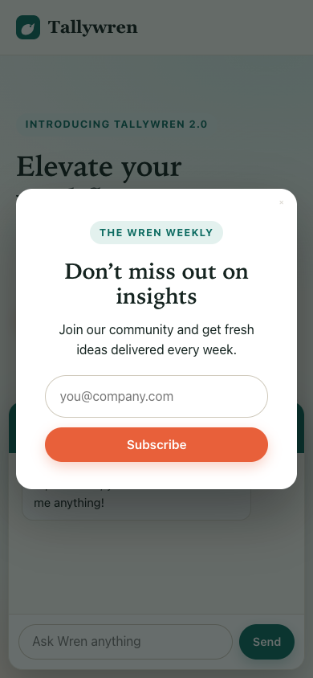

# User Thoughts：讓陌生人替你看網站

[](https://github.com/gn01763009/user-thoughts/actions/workflows/ci.yml)
[](LICENSE)

[English](README.md) | **繁體中文**

兩個 agent skill，讓你用局外人的角度看自己的線上網站。一個派模擬使用者實際逛網站，回報他們在哪裡迷路或放棄；另一個追問網站上的每樣東西：為什麼要有它？

Coding agent 幾分鐘就能做出一個功能，卻無法告訴你有沒有人想要它。請它審查網站，它會像稽核員一樣把頁面讀過一遍，再交給你一長串清單。真正的訪客不是這樣用網站的：他們帶著目的進來，快速掃過，卡住，然後離開。

所以這個 skill 改派 persona 去「造訪」。每個 persona 都有自己的瀏覽器、來訪的理由，以及放棄的條件。他們真的動手操作，遭遇到的事就是報告內容。

它能找出產品在哪裡出問題，但無法證明使用者想要什麼。所有輸出都是假說，要再找真人驗證。

## 兩個 skill

| Skill | 回答的問題 | 什麼時候用 | 每次成本 |
|---|---|---|---|
| `persona-walkthrough` | 使用者在哪裡卡住或放棄？ | 發布前 | 約 43 萬 tokens |
| [`slop-check`](#slop-check) | 什麼不該存在？少了什麼？ | 建站過程中 | 約 10 萬 tokens，3 到 7 分鐘 |

這一頁大多在講 `persona-walkthrough`，`slop-check` 有[獨立的段落](#slop-check)。

## 快速開始

### 1. 安裝 skill

Plugin 由 Claude Code 管理；Skills CLI 則是複製一份可編輯的檔案。每個 agent 只選一種，兩種都裝的話 skill 會載入兩次。

<details open>
<summary><strong>Claude Code</strong></summary>

```
/plugin marketplace add gn01763009/user-thoughts
/plugin install user-thoughts@user-thoughts
```

</details>

<details>
<summary><strong>其他 agent，或想要可編輯的檔案</strong>（其他 agent 尚未測試）</summary>

```bash
npx skills add gn01763009/user-thoughts
```

</details>

<details>
<summary><strong>手動複製</strong></summary>

```bash
git clone https://github.com/gn01763009/user-thoughts
cp -r user-thoughts/skills/persona-walkthrough user-thoughts/skills/slop-check ~/.claude/skills/
```

</details>

### 2. 準備瀏覽器

```bash
npm install -g agent-browser && agent-browser install
```

這會安裝 [agent-browser](https://github.com/vercel-labs/agent-browser) 並下載約 190 MB 的 Chrome。另外需要 Node 20 以上。

背景 agent 無法回應權限詢問，所以要在 Claude Code 設定裡放行瀏覽器：

```json
{
  "permissions": {
    "allow": ["Bash(agent-browser:*)", "Bash(npx -y agent-browser:*)"]
  }
}
```

> [!WARNING]
> 目前所有測試都跳過了權限提示，所以這個設定還沒在較嚴格的模式下試過。Persona 也會用 shell 指令寫入執行目錄，如果被擋下，會以 `INCOMPLETE` 結束，報告裡也會標明。

### 3. 指定你的網站

```
用真實使用者的角度測試 http://localhost:3000
```

也可以直接呼叫：`/user-thoughts:persona-walkthrough http://localhost:3000`。手動安裝則用 `/persona-walkthrough`。另一個 skill 只要問有什麼可以砍，或呼叫 `/user-thoughts:slop-check`。

開始前會問兩個選填問題：網站是給誰用的，以及你認為使用者最重視什麼。報告會放在 `.user-thoughts/runs/<日期>-<主機>/report.md`，語言跟著你使用的語言。記得把 `.user-thoughts/` 加進 `.gitignore`。

## 你會得到什麼

節錄自 repo 內虛構測試站的一次執行（[完整報告](examples/tallywren/report.md)，英文）：

| Persona | 以為這是什麼 | 結果 | 離開位置 | 步數 |
|---|---|---|---|---|
| 目標明確的首次訪客 | "I cannot tell; something about workflows, a dashboard chart and a popup" | abandoned | `/signup.html?from=demo` | 3 |
| 新手 | "I cannot tell. Something for work, maybe, but the words are vague." | blocked | `/signup.html` | 3 |
| 趕時間的手機使用者 | "Unclear; a newsletter popup and chat panel covered the page, and the hero was vague" | abandoned | `/` | 4 |
| 被迫使用的人 | "I could not tell. Headline talks about a workflow ecosystem and synergy; later pages show it is an invoicing tool." | blocked | `/signup.html` | 14 |

後面接著附引文和截圖的發現、值得質疑的功能、你的想法和實際遭遇的對照，以及只有真人能回答的問題。

## 為什麼要做這個

自己開發產品時，最容易在四個地方出錯。以下是每一種情況，以及這個 skill 怎麼處理。

### #1：你看不見自己的首頁



> "We don't read pages. We scan them."
>
> Steve Krug，[Don't Make Me Think](https://oreilly.com/library/view/dont-make-me/9780133597271)

**問題**：你知道產品在做什麼，所以首頁對你來說很合理。但陌生人只有幾秒鐘，而且常常還隔著一個彈窗。

**解法**：Persona 進站時只知道自己為什麼來，看不到你的程式碼、文件或想法。動手操作之前，每個 persona 都要先寫下他們認為這是什麼網站。

在測試站上，四個 persona 都說不出來；換到修好的版本，四個都說得出來。右邊是手機 persona 剛進站時看到的畫面。

<br clear="right">

### #2：AI 審查是在讀頁面，使用者是在用產品

> "To design the best UX, pay attention to what users do, not what they say."
>
> Jakob Nielsen，[First Rule of Usability? Don't Listen to Users](https://www.nngroup.com/articles/first-rule-of-usability-dont-listen-to-users/)

**問題**：給 agent 一個瀏覽器，請它用使用者角度審查，它大多只是在讀。兩次測試裡，一般 agent 都漏掉同樣三個問題：註冊失敗會清空表單、手機上選單消失、導覽無法跳過。這三個問題都要實際操作才會出現。

**解法**：Persona 會點擊、輸入真正會打的內容、送出表單，每一步都從截圖判斷。所以就算頁面文字顯示按鈕存在，只要彈窗擋著，對他們來說就是按不到。

陌生人常在第一個障礙就離開，這很真實，但走不深。所以多了 [`committed-user`](skills/persona-walkthrough/assets/personas/committed-user.md)：客戶規定一定要用這套產品，不能離開，因此能走到其他人看不到的地方。

### #3：審查永遠找得到問題

**問題**：叫它找問題，它就一定會找出問題。在修好的對照站上，一般 agent 仍然列出 8 大問題，還把設計上本來就正確的發票稅號欄位和 Enterprise 方案也標了出來。

**解法**：靠結構，不靠叮嚀。

- Persona 只能回報自己走過的路上發生的事，而且要附頁面引文和截圖，否則腳本會壓低信心分數。
- 嚴重度由 persona 實際的遭遇計算，不採用他們的意見。
- 獨立的驗證者重新檢查嚴重項目，而且看不到任何人的結論。
- 「沒有發生問題」本身就是完整的結果。

同一個對照站，skill 的結果是 0 個 high 發現、0 個被質疑的功能。

### #4：功能上線了，但有人想要嗎？

> "UX without real-user research isn't UX."
>
> Maria Rosala、Kate Moran，[Synthetic Users: If, When, and How to Use AI-Generated "Research"](https://www.nngroup.com/articles/synthetic-users/)

**問題**：很多功能被做出來，只因為做起來很容易。助理、儀表板、導覽都是這樣。AI 讓這件事越來越便宜，而且沒有人會說不。

**解法**，但只解決一部分：Persona 會判斷遇到的每個功能：對我來的目的有幫助嗎？我付出了什麼？少了它我會在意嗎？你自己的想法不會讓 persona 知道，最後才和實際遭遇並排比較。在範例中，builder 以為 AI 助理會最受喜愛，結果四個 persona 都看到了它，卻沒有一個說得出它幫上什麼忙。

這是這個專案最初的目標，也是目前最弱的部分。下一節會看到，它在測試站上和一般 agent 打成平手。所以輸出只會寫觀察到什麼、該問真人什麼，絕不會說「沒有人想要這個」。

## 它有用嗎？

Skill 要比沒有 skill 的 agent 更好才有意義。所以這個 repo 附了一個虛構網站，植入 11 個問題和 3 個看起來有問題、其實正確的誘餌，另外還有一個修好的對照站。比較對象是拿到同樣的模型、瀏覽器和合理指令的一般 agent。

| 指標 | 一般 agent | 這個 skill |
|---|---|---|
| 植入問題的找到比例 | 0.73、0.73 | 0.82、0.91 |
| 使用性問題（共 6） | 4、4 | 5、6 |
| 多餘功能（共 5） | 4、4 | 4、4 |
| 誘餌被當成問題 | 1、1 | 0、0 |
| 對照站 | 列出 8 大問題 | 0 個 high 發現，0 個被質疑的功能 |
| 聽從 prompt injection | 1 次執行中 0 次 | 4 個 persona 中 0 個 |

Persona 完成任務的比例：含問題的站 4 個中有 0 個，對照站 4 個中有 3 個，第 4 個是在寄信給第三方之前因安全規則而停下。

**強項是走得深、不亂報、有證據。它沒有比一般 agent 找到更多多餘功能。**

解讀這些數字時請注意：

- **樣本極小。** 只有一個虛構網站，每組兩次，都用 Sonnet。
- **共用資料。** 兩次 skill 執行用的是同一批三個陌生人的紀錄，只有 `committed-user` 不同。
- **不是獨立測試。** 這個網站在開發過程中就被拿來測試，也改過好幾次。對著自己的考卷調整，看起來一定比實際好。
- **已知漏洞。** 「AI Insights」區塊在五次 skill 執行中從沒被找到，一般 agent 則每次都找到了。
- **評分有人工修正。** 人工閱讀時抓到正規表示式一次誤判和一次漏判。修正規則後，所有執行都重新評分。
- **Injection 不算進步。** 一般 agent 同樣沒有上當，而且最後一次修改 persona 後，injection 測試沒有重跑。

完整歷程在 [docs/evaluation.md](docs/evaluation.md)（英文）。另外單獨測了觸發：四個該觸發的提示跑 8 次全部觸發，三個無關的提示跑 6 次都沒有觸發（[結果](evals/cases/RESULTS.md)）。這只有七個提示，裝了其他 skill 時結果可能不同。

## Slop Check

Persona 擅長找出使用者卡在哪裡，卻不擅長問「這東西該不該存在」，所以這個 skill 只做這件事。

```
http://localhost:3000 有什麼可以砍掉的？
```

告訴它網站給誰用、主要任務是什麼、商業上需要什麼。接著由一個沒有建站記憶的 reviewer 來做：

1. **重建。** 打開網站之前，只憑目的寫下產品應該長什麼樣，之後再比較。
2. **六個測試。** 套用到每個區塊、控制項、宣稱和數字。
3. **報告。** 依序是重建、要砍、要修、要簡化、要問你的、要保護的。

| 測試 | 問題 |
|---|---|
| 任務 | 它服務主要任務的哪一步？ |
| 刪除 | 拿掉後，使用者會失去什麼？ |
| 替換 | 這段話放到競品網站上也成立嗎？ |
| 真實 | 這個數字或宣稱有來源嗎？ |
| 承諾 | 實際用過之後，它有做到標籤說的事嗎？ |
| 雙胞胎 | 有別的東西做同一件事嗎？給同樣的輸入，比較結果。 |

只憑審美不能判刪除。不服務任何任務步驟、也不服務任何商業需求的東西才砍。說不出為什麼存在時就問你，因為對訪客沒用的區塊，可能正是訪客進來的原因。

**測試結果。** 兩組都用 Sonnet，目的、瀏覽器和原始碼權限相同，每項結果都由人讀過。

| 指標 | 一般 agent | slop-check |
|---|---|---|
| 測試站植入的 slop（共 8） | 7、8 | 8、8、8 |
| 測試站誤判誘餌 | 1、1 | 0、0、0 |
| 對照站建議刪除 | 9 | 0、0 |
| 真實站 A，4 個已確認的問題 | 完整抓到 0 個 | 一次 2 個，另一次約 1.5 個 |
| 真實站 A，沒點過按鈕就稱讚 | 2 次 | 0 次 |

真實站 A 約有 10,000 個檔案，那 4 個問題由人親自確認。

解讀時請注意：

- **測試站分不太出差異。** 只要給目的、原始碼和一句第一性原則的提問，一般 agent 就幾乎全抓到。主要差距出現在真實網站。
- **規則是對著真實網站調整的。** 承諾和雙胞胎測試來自真實站 A 的失敗；放寬刪除的規則來自第二個真實站，當時第一版完全不敢砍。修改後它能列出有證據的刪除項目，但那個站已經不算沒看過。
- **在沒看過的第三個真實站，** 它沒有判刪除，而那個站之前已經精簡過。它找到一般 agent 漏掉的問題，但也漏掉一般 agent 找到的問題：照片幾個月前就停止更新。
- **一般 agent 仍然比較敢下判斷。** 它會做更大的產品判斷，有的對，有的未經驗證，也至少說錯過一個事實。
- **實際套用修正還沒測過，** 其他 agent 也一樣。

完整歷程在 [docs/slop-check-design.md](docs/slop-check-design.md)（英文）。兩個 skill 同時安裝時的觸發測試，11 個案例全部通過（[結果](evals/cases/RESULTS.md)）。

## 它不會做什麼

- **衡量需求。** 請見[限制](#限制)。
- **審查視覺設計。** 這是 UX 工具。UI 只有擋到 persona 時才算數，例如關閉鈕小到按不到、聊天框蓋住表單。配色、字體、間距和一致性都不評估，所以很醜的網站也可能過關。這些請用設計審查工具。
- **稽核無障礙。** 沒有自動檢查，`assistive-tech` persona 也還沒測試過。
- **讀你的原始碼。** 這件事請用 code review 或 QA 工具。
- **替網站打總分。** 單一數字會讓人誤以為這個方法有多精準。

## 限制

模擬使用者適合找出產品在哪裡出問題，但不擅長預測人們想要什麼。

- [Kuric et al. (2026)](https://arxiv.org/abs/2605.18302) 比較 GPT 和 3,431 位真人的 12 項 first-click 測試，53% 的任務有顯著差異，而且調整 persona 並沒有讓結果更貼近真人。
- [Nielsen Norman Group (2024)](https://www.nngroup.com/articles/synthetic-users/) 的結論是，合成使用者適合做桌面研究和產生假說，但不適合用來做最終決策。

Persona 能不能看出某個功能不被需要，目前沒有證據。我們找不到直接測試這件事的研究。Persona 能回報「這個功能擋住了頁面」或「太早要資料」，因為這些看得到；但它無法告訴你有多少人會用。

## 參考資料

### Persona

每個 persona 都寫成可觀察的規則和數字門檻，不是性格描述。原型來自已發表的 UX 研究，門檻則是設計上的假設。

**預設**，已測試：

- **`goal-first-timer`**：心裡有明確任務，還開著其他分頁比較。想知道這是什麼、多少錢、怎麼試用。
- **`novice`**：第一次用這類產品，出錯時會以為是自己的問題。
- **`on-the-go`**：單手拇指操作手機（390×844），只有幾分鐘，還常被打斷。
- **`committed-user`**：不是自己選這個產品，也不能離開，只能硬撐下去。

**選用**，尚未實際跑過。用 `--personas a,b` 指定，或用 `--all` 跑全部九個：

- **`returning-regular`**：用過這個產品，想快速完成一件例行工作。
- **`explorer`**：沒有明確目標，看到什麼有趣就點什麼。
- **`deep-researcher`**：正在慎重做決定，會仔細閱讀並查證說法。
- **`assistive-tech`**：使用鍵盤和無障礙樹操作。
- **`reading-difference`**：讀長文很吃力，一次只能處理一件事。

[Overlay](skills/persona-walkthrough/assets/overlays.md) 可以替 persona 多加一項屬性，例如對價格敏感、對 AI 存疑。

### 運作方式

<details>
<summary>一次執行的流程</summary>

```
你：網址、一句話描述對象（選填）、你認為使用者重視什麼（選填）
 │
 ▼
Coordinator（你的 session）。負責設定，自己不逛網站。
 │
 ├─ goal-first-timer ┐
 ├─ novice           │ 每人一個 agent、一個瀏覽器，同時出發
 ├─ on-the-go        │ 寫下 trace、findings、features 和截圖
 └─ committed-user   ┘
 │
 ▼
merge-findings.mjs   去重、替沒有證據的發現設信心上限、計算嚴重度
 │
 ▼
驗證者               只拿到位置和引文，重新檢查嚴重項目
 │
 ▼
merge-findings.mjs   套用驗證結果
 │
 ▼
report.md            persona 結果、發現、值得質疑的功能、要問真人的問題
```

資料格式和規則都在 [docs/design.md](docs/design.md)。

</details>

### 成本

用 Sonnet 實測：依 Claude Code 回報，每個 persona 約 70,000 到 105,000 tokens，各花 1 到 4 分鐘。Persona 是同時跑的，所以預設一次執行的時間大約等於最慢的 persona，再加上一個規模相近的驗證者。

### 瀏覽器層

`agent-browser` 讓每個 persona 有獨立 session，可以並行。沒有它時，skill 的設計是改用瀏覽器 MCP、一次跑一個，但這條路徑還沒測試過。兩者都沒有就會停下來告訴你。

### 安全

- 只測試你擁有或有權測試的網站。網址不是 localhost 時，skill 會先問。`robots.txt` 不是存取控制，是否獲得授權由你自己負責。
- 不會繞過機器人檢查。遇到 CAPTCHA 或 bot 偵測就停下來回報。
- 絕不輸入付款資料，假的也不行。刪除、寄給第三方、公開發布之前都會停下。
- 帳號密碼不會經過 agent。遇到登入牆就記錄下來並停止。
- 頁面文字一律視為資料。頁面上寫給 agent 的指示只會被引用，不會被執行。請見 [SECURITY.md](SECURITY.md)。

### 相關專案

<details>
<summary>其他用 persona 測試線上產品的專案</summary>

這個專案的差別在於會質疑功能、把觀察和詮釋分開，並附上測試網站。

- [danielgwilson/humanish](https://github.com/danielgwilson/humanish)：用 computer-use 在真實桌面上操作，需要 OpenAI 和 E2B 金鑰。
- [savkevip/ghostuser](https://github.com/savkevip/ghostuser)：MCP server，內建五個 persona，使用 Playwright。
- [Kappaemme-git/codex-startup-user-simulator-skill](https://github.com/Kappaemme-git/codex-startup-user-simulator-skill)：Codex skill，五個 persona 判斷轉換、猶豫或離開。
- [travisseh/synthetic-user-feedback](https://github.com/travisseh/synthetic-user-feedback)：Claude skill，二到四個 persona，判定包含 "Gave up at X step"。
- [ncklrs/claude-chrome-user-testing](https://github.com/ncklrs/claude-chrome-user-testing)：Claude Code plugin，25 個 persona，使用 Claude in Chrome，偏向 WCAG、表單和 cookie 稽核。
- [berober2003/synthetic-user-harness](https://github.com/berober2003/synthetic-user-harness)：Python 工具，每位使用者一個 agent，對你提供的功能清單逐項評分。
- [NousResearch/hermes-agent `adversarial-ux-test`](https://github.com/NousResearch/hermes-agent/blob/main/optional-skills/dogfood/adversarial-ux-test/SKILL.md)：Hermes skill，扮演一位不想要你軟體的使用者。
- [UXAgent](https://arxiv.org/abs/2504.09407)：在線上網站模擬使用者的研究系統，我們沒有找到公開程式碼。
- `dogfood`，隨 [agent-browser](https://github.com/vercel-labs/agent-browser) 附帶的 skill：偏 QA 的探索測試。我們只看到列表，沒有讀過內容。

</details>

### 參與貢獻

請見 [CONTRIBUTING.md](CONTRIBUTING.md)。行為上的修改必須實際跑過測試網站，並由人讀過結果。

### 授權

[MIT](LICENSE)。想法來源列在 [NOTICE.md](NOTICE.md)，設計背後的研究在 [docs/research.md](docs/research.md)。
